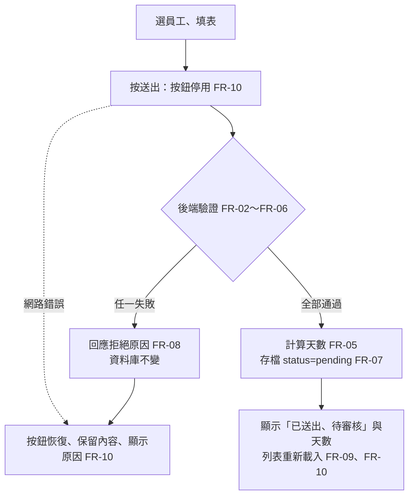

# 03 SRS — LeaveBot 請假系統

- 上游：`docs/02-prd.md`（AC-01.1～AC-03.2）、`docs/01-brief.md`（D-01～D-03）、`course/01-上課/03-LEAVEBOT.md`
- 版本：v0.1
- 狀態：草稿。核心規則已可判定，但「矛盾與未決」中有兩項需要講師或小組決定。
- 負責人：本小組
- 審查者：講師
- 日期：2026-10-28

## 功能需求

| ID | 可觀察的系統行為 | 來源 AC |
|---|---|---|
| FR-01 | 系統提供預先設定的員工名單，供下拉選單選擇。 | AC-01.1、AC-03.1 |
| FR-02 | 送出時缺少員工、假別、開始日期、結束日期或時段任一欄 → 拒絕，不寫入資料。 | AC-02.1 |
| FR-03 | 員工不在名單中、假別不是 `annual`／`personal`／`sick`，或時段不是 `full`／`am`／`pm` → 拒絕，不寫入資料。 | AC-02.1 |
| FR-04 | 日期無效或結束日期早於開始日期 → 拒絕，不寫入資料。系統不和「今天」比較，過去日期一樣接受。 | AC-02.1、AC-01.3 |
| FR-05 | 由後端計算天數：包含首尾日期，只算週一至週五。整天每個工作日算 1 天；上午或下午只能是單日，而且當天必須是工作日，算 0.5 天。結果為 0 個工作日 → 拒絕，不寫入資料。 | AC-01.1、AC-01.2、AC-01.3、AC-02.1 |
| FR-06 | 理由選填，去掉前後空白後最多 200 字；超過 → 拒絕，不寫入資料。只有空白的理由視為未填。 | AC-01.4、AC-02.2 |
| FR-07 | 驗證全部通過 → 新增一筆假單，狀態固定為 `pending`，天數使用 FR-05 的結果；回應中帶回這筆假單的狀態與天數。 | AC-01.1、AC-01.2、AC-01.3 |
| FR-08 | 任一驗證失敗 → 回應拒絕原因，資料庫筆數不變。 | AC-02.1、AC-02.2 |
| FR-09 | 依員工查詢假單：只回傳該員工的申請，不混入其他員工；資料存在 SQLite，重新整理頁面或重啟服務後仍在。 | AC-03.1、AC-03.2 |
| FR-10 | 前端送出期間停用「送出」按鈕，收到回應後恢復。成功時顯示「已送出、待審核」與天數，並更新列表；失敗或網路錯誤時保留已填內容並顯示原因。 | AC-01.5、AC-02.3、AC-01.1 |

## 規則與資料字典

驗證全部在後端進行。前端只負責收集欄位、鎖住按鈕和顯示結果，前端的檢查不能取代後端（STACK）。只有全部規則都通過，才會寫入資料；任一條失敗，資料庫就不變（FR-08）。

**使用者可控欄位**

- 員工（FR-01、FR-03）：必填，值必須是 FR-01 名單中的員工。空值或名單外的值一律拒絕。名單內容與識別方式由 SDS 決定。
- 假別（FR-02、FR-03）：必填，只接受 `annual`（特休）、`personal`（事假）、`sick`（病假）。其他值拒絕，包括 C4 fixtures 的其他假別。
- 開始日期、結束日期（FR-02、FR-04）：必填，必須是存在的日曆日期，例如 `2026-02-30` 無效。條件是結束日期 ≥ 開始日期，相同日期合法。不比較「今天」，所以 2026-10-19 這類過去日期合法（D-02）。日期格式由 SDS 決定。
- 時段（FR-02、FR-03、FR-05）：必填，只接受 `full`（整天）、`am`（上午）、`pm`（下午）。實際傳輸值由 SDS 確認。
- 理由（FR-06）：選填，以純文字保存與顯示，不執行、不渲染 HTML（`03-LEAVEBOT.md`）。
  - 字數算法：先去掉前後空白，再逐字計算；中文、英文、標點各算 1 字。中間的空白和換行照算。
  - 邊界：去空白後 200 字接受，201 字拒絕。空字串或只有空白視為未填，接受。

**伺服器決定欄位**

- 天數（FR-05、FR-07）：由後端依下表計算。
- 狀態（FR-07）：新假單一律是 `pending`，畫面顯示「待審核」。
- 客戶端就算送了天數或狀態，也不會影響存檔結果。

**天數決策表**

| 時段 | 日期範圍 | 結果 |
|---|---|---|
| `full` | 開始 ≤ 結束，範圍內有 n ≥ 1 個工作日 | 接受，天數 = n |
| `full` | 範圍內 0 個工作日 | 拒絕（零工作日） |
| `am`／`pm` | 開始 = 結束，而且是週一至週五 | 接受，天數 = 0.5 |
| `am`／`pm` | 開始 = 結束，但是週六或週日 | 拒絕（零工作日） |
| `am`／`pm` | 開始 ≠ 結束 | 拒絕（半天限單日） |
| 任一時段 | 結束 < 開始 | 拒絕（日期反向），不再計算天數 |

**邊界例子**

以下預期值可以獨立核算，2026 年的星期已核對過；不需要「今天」也能算出。

| 例子 | 時段 | 預期 | 依據 |
|---|---|---|---|
| 2026-11-02（一）～11-04（三） | `full` | 3 天 | AC-01.1 |
| 2026-11-02（一）單日 | `full` | 1 天 | 相同日期合法 |
| 2026-11-02（一）～11-08（日） | `full` | 5 天 | 扣週末 |
| 2026-11-06（五）～11-09（一） | `full` | 2 天 | AC-01.2，跨週末 |
| 2026-11-06（五）單日 | `am` | 0.5 天 | AC-01.2 |
| 2026-10-19（一）～10-20（二） | `full` | 2 天，接受 | AC-01.3，過去日期 |
| 2026-11-07（六）～11-08（日） | `full` | 拒絕 | 零工作日 |
| 2026-11-07（六）單日 | `pm` | 拒絕 | 半天但當天不是工作日 |
| 2026-11-02（一）～11-03（二） | `am` | 拒絕 | 半天限單日 |
| 2026-11-04（三）～11-02（一） | `full` | 拒絕 | 日期反向 |

**列表隔離**（FR-09）

查詢員工 A 時只回傳 A 的假單。例如 A 有 2 筆、B 有 1 筆時，查 A 得到 2 筆，查 B 得到 1 筆。每筆至少帶回日期範圍、假別、時段、天數與狀態（AC-03.1）。

## 品質需求

- NFR-01｜拒絕不留副作用：任何不合法輸入，包括 FR-02～FR-06 的每一類，都不會讓資料筆數增加。驗證方式：自動化測試比對送出前後的筆數。
- NFR-02｜輸入安全：理由含 `<b>x</b>` 或 `'); DROP TABLE` 這類字串時，照原文保存，畫面照原文顯示，不會變成 HTML，也不會影響資料庫。驗證方式：用暫存資料庫做自動化測試，加上人工檢查畫面。實作約束見 STACK，包括 SQL 參數與 `textContent`。
- NFR-03｜持久性：服務重啟後，先前的假單仍可查詢。驗證方式：人工重啟服務，或測試中重新開啟同一個暫存資料庫。
- NFR-04｜可測性：測試使用暫存資料庫，不讀寫開發資料庫；天數計算不依賴真實日期（AGENTS.md、STACK）。驗證方式：測試設定審查。
- 效能：課堂單機、單一使用者情境，沒有效能需求依據，所以不設門檻。等之後量測，再決定要不要訂。

## 流程與未決事項

### 矛盾（需要講師決定，不擅自選邊）

- **X-01「今天」的固定值不一致**：STACK 寫「若規則使用今天，課堂固定 `2026-10-12`」，PRD 的例子則假設今天是 2026-10-28。本 SRS 的規則不使用「今天」（D-02），所以沒有任何預期值會因此改變。但 AC-01.3 用「今天是 2026-10-28」來說明「過去日期」；如果以 10-12 為準，2026-10-19 就變成未來日期，這個 AC 就測不到「補請」。
  - 影響：AC-01.3 與後續 TC 的例子。
  - 決策人：講師。期限：寫 TC（卡 F）前。
- **X-02 客戶端送來天數或狀態時怎麼處理**：`03-LEAVEBOT.md` 寫「不接受客戶端指定狀態或天數」。這可以解讀成「忽略後照算」，也可以是「整筆拒絕」，兩種都符合原文，但測試預期不同。本 SRS 只承諾「不影響存檔結果」。
  - 影響：FR-07、SDS 的 API 合約、TC。
  - 決策人：講師或小組。期限：寫 SDS（卡 E）前。
  - **已決（2026-10-28，小組）**：整筆拒絕，回 422 `unknown_field`。見 `docs/05-sds.md` S-01。

### 未決（不阻塞核心規則）

以下四項都已在 2026-10-28 由小組決定，記在 `docs/05-sds.md` 的決策紀錄：

- 同時違反多條規則時，回傳全部原因還是第一個，以及各類拒絕的錯誤碼與文案。**已決：S-02。**
- 查詢列表時傳入名單外的員工，要回傳空列表還是錯誤。**已決：S-03，回 404。**
- 列表排序、空狀態文案；理由去空白後的保存方式，以及未填存成空字串還是空值（沿用 PRD 待決）。**已決：S-04。**
- 「1 字」在罕見字元上的定義。**已決：S-04，用 Python `len`，接受表情符號可能算成多個字。**

> 審查重點：每條 AC 可追到 FR／NFR；需求不互相矛盾；合法、非法、邊界與持久副作用可判定；設計與測試者可獨立算出預期結果。
