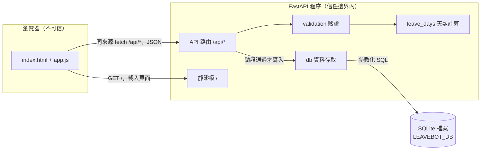

# 04 SAD — LeaveBot 請假系統

- 上游：`docs/02-prd.md`、`docs/03-srs.md`（FR-01～FR-10、NFR-01～NFR-04）、流程圖 `diagrams/submit-leave.html`
- 技術限制：`course/01-上課/04-STACK.md`
- 版本：v0.1
- 狀態：草稿，待講師審查
- 負責人：本小組
- 審查者：講師
- 日期：2026-10-28

## 情境與品質驅動

最重要的路徑是員工選自己、填表、送出，然後在「我的假單」看到這筆待審核的申請（US-01、US-03）。其次是不合法輸入被擋下、不留資料（US-02）。

- 資料敏感性：只有虛構員工的姓名和請假理由。理由是使用者自由輸入的文字，必須視為不可信資料（NFR-02）。
- 故障影響：存檔失敗時，員工以為請假成功卻沒有登記，這正是本題要解決的問題（Brief G-01）。因此，任何失敗都必須回到畫面，不能出現「看起來成功」的情況。
- 相關 NFR：拒絕不留副作用（NFR-01）、輸入安全（NFR-02）、持久性（NFR-03）、可測性（NFR-04）。
- 環境：課堂單機，一個 uvicorn 程序，瀏覽器連 `http://127.0.0.1:8000/`。**正式部署不在本課範圍。**

## 元件與資料流

信任邊界在瀏覽器和 FastAPI 之間：

- 送進 `/api/*` 的資料一律由後端重新驗證；前端不做業務驗證，也不決定天數和狀態（FR-05、FR-07）。
- 路由收到請求後，交給 `validation`：先查欄位，再交給 `leave_days` 算天數。全部通過時，`db` 才在一個交易中寫入一筆 `status='pending'` 的假單；任一規則失敗就直接回 422，完全不碰寫入（FR-08、NFR-01）。
- 列表查詢只依路徑中的員工代號過濾（FR-09）。
- 回應回到瀏覽器後，`app.js` 一律用 `textContent` 顯示文字（NFR-02）。
- 存檔或讀取失敗時回 500，畫面顯示「無法存檔，請稍後再試」，並保留表單內容（FR-10）。

| 元件 | 責任／擁有資料 | 失敗時怎麼處理 |
|---|---|---|
| 前端 `static/` | 收集欄位、送出期間停用按鈕、顯示結果與列表（FR-10、FR-01、FR-09） | 收到 422 時列出原因；收到 500 或網路錯誤時顯示通用訊息；兩種情況都恢復按鈕、保留內容 |
| API 路由 `main.py` | 解析 JSON、呼叫驗證、決定 HTTP 狀態碼；路由一律先登記，最後才掛靜態檔 | 本文不是 JSON 物件時回 422；資料庫例外時回 500，不洩漏內部訊息 |
| `validation` | 欄位規則與跨欄位規則，產生錯誤清單（FR-02～FR-06） | 純函式，不讀寫資料庫，只回傳錯誤 |
| `leave_days` | 依工作日與時段計算天數（FR-05） | 純函式；結果為 0 時，由 `validation` 轉成 `no_workdays` 錯誤 |
| `db` | 建表、建立種子員工、寫入與查詢假單；擁有 SQLite 檔案（FR-01、FR-07、FR-09） | 寫入在交易中進行，失敗就回滾；連線在 `finally` 關閉 |
| SQLite 檔案 | 持久保存員工與假單（NFR-03） | 用表格層的 CHECK 約束擋下非法狀態，作為第二道防線 |

## 重要決策與取捨

STACK 已固定 FastAPI、原生前端、sqlite3、同來源且不開 CORS，這裡不重寫。以下三個決策都有真正的替代方案。

### ADR-01 自寫驗證函式，不用 Pydantic 請求模型

決定：路由以 `await request.json()` 取得原始物件，交給純函式 `validate_leave_request` 檢查，回傳本專案的錯誤清單（格式見 SDS）。

考慮過：用 Pydantic 模型加上 `extra="forbid"`。程式比較短，但它的預設錯誤格式和英文訊息不符合 SDS 要求的 `{"errors":[{field, code, message}]}`。改用它就必須寫一層例外轉譯，把 Pydantic 的錯誤類型對應回 `missing`、`unknown_field` 等本專案錯誤碼；而且日期格式寬鬆，例如它也接受 `20261102`，要另外收緊。

影響與驗證：

- 每個錯誤碼都能直接對應到 SRS 規則，單元測試不必啟動 HTTP。
- 代價是要自己處理型別檢查。
- 用 SDS 錯誤碼表中每一列的單元測試，確認這個取捨可接受。
- 可逆性高：之後要改成 Pydantic 時，只要保持錯誤格式不變，對外契約不受影響。

### ADR-02 用 `create_app()` 注入資料庫路徑與「今天」

決定：`app/main.py` 提供 `create_app(db_path=None, today=None)`，並在模組層保留 `app = create_app()` 給 uvicorn 使用。

- 參數優先；沒給時讀 `LEAVEBOT_DB`、`LEAVEBOT_TODAY`，最後才用預設值。
- 建表在 lifespan 啟動時進行，所以 `import` 本身不會建立開發資料庫。

考慮過：只靠環境變數，加上在測試中改 `os.environ`。這樣測試之間容易互相污染，而且模組在 import 時就決定了路徑。

影響與驗證：

- 每個測試都可以用 `tmp_path` 建立自己的 app（NFR-04）。
- 驗證方式：測試結束後，確認開發資料庫檔案沒有被建立或修改。

### ADR-03 表格層限制 `status` 只能是 `pending`

決定：`leave_requests.status` 加上 `CHECK (status = 'pending')`，而且 INSERT 不帶入任何來自客戶端的狀態值。

考慮過：只靠程式保證。這樣比較好擴充，但少了第二道防線。

影響與驗證：

- 這是 FR-07 的不變量。之後要做 C1 主管核准時，必須遷移這個約束，這筆成本我們接受。
- 驗證方式：用 SQL 直接插入其他狀態時，應該失敗。

## 運作、風險與未決

- 啟動與設定：依 STACK 用 uvicorn 啟動。`LEAVEBOT_DB` 預設 `backend/data/leavebot.db`，啟動時自動建立目錄與資料表。資料庫檔不進版控，由票 000 把它加入 `.gitignore`。
- 可觀察錯誤：500 回應只給通用訊息，例外細節記在伺服器終端機。
- 備份、恢復、監控、回退：不適用，因為本次只在本機執行。刪除資料庫檔後重啟，就會得到只有種子員工的乾淨資料庫。
- 正式上線前的缺口：
  - 身分驗證：現在任何人都能選任何員工（NG-01）。
  - HTTPS 與部署設定。
  - 資料庫備份與 schema 遷移工具。
  - 多人同時寫入時的鎖定與效能量測。
  - 人資確認請假規則。
  - 結構化日誌。
- 風險：前端沒有預先檢查，使用者要送出後才知道錯誤。這是為了讓前後端規則只有一份；錯誤一次全部回傳，可以降低來回修改的次數（S-02）。
- 待決：SRS X-01（課堂固定的「今天」是哪一天）仍由講師決定。目前沒有任何規則讀取「今天」，所以設計不受影響，只影響 AC-01.3 測試注入的日期。

> 審查重點：每個元件有責任；信任與資料邊界清楚；關鍵失敗模式有對策；取捨和需求相容；沒有聲稱未驗證的上線能力。
